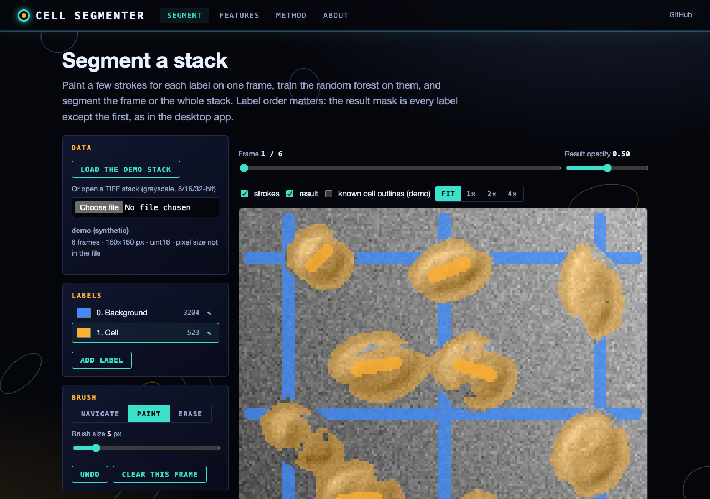
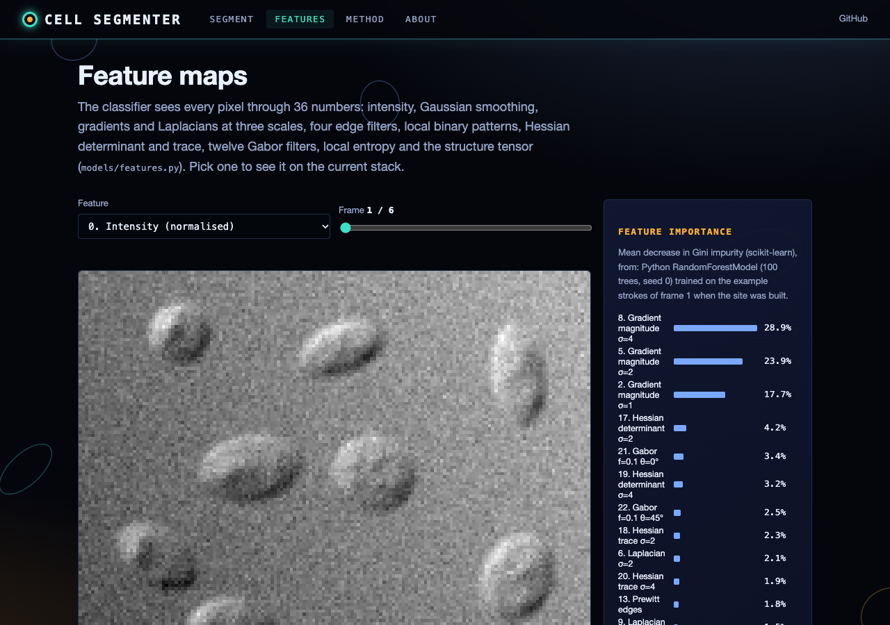
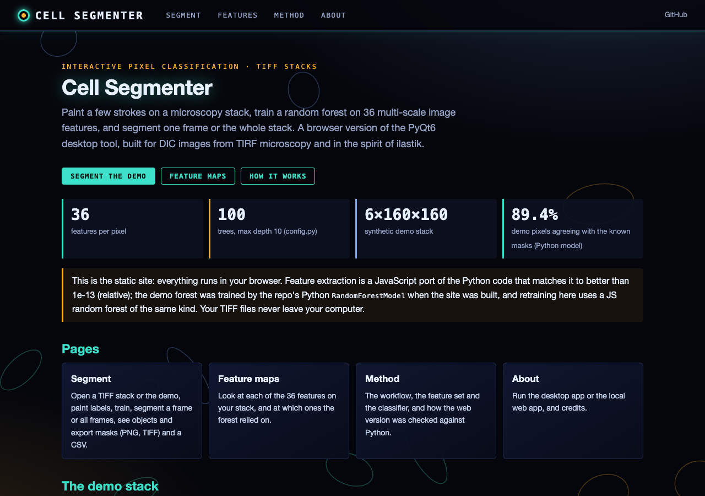

# Cell Segmentation Tool

A PyQt-based application for segmenting and analyzing microscopy image sequences, specifically designed for DIC (Differential Interference Contrast) images from TIRF microscopy. The tool provides an interactive interface for training machine learning models to segment cellular structures.

## Features

- Load and view multi-frame TIFF stacks
- Interactive painting tools for creating training data
- Multiple segmentation approaches:
  - Random Forest classifier
  - Convolutional Neural Network (CNN)
- Real-time visualization of segmentation results
- Batch processing capabilities
- Training data management:
  - Multiple label classes
  - "Undo Last" (clears the selected label's strokes on the current frame)
  - Label class editing and removal
  - Training uses the strokes of the current frame (the "Use training data from all frames" checkbox is not wired up yet)

## Installation

### Prerequisites

- Python 3.8 or higher
- pip package manager

### Dependencies

```bash
pip install -r requirements.txt
```

Main dependencies include:
- PyQt6
- pyqtgraph
- numpy
- scikit-image
- scipy
- torch
- tifffile

### Installation Steps

1. Clone the repository:
```bash
git clone https://github.com/gddickinson/cell-segmenter.git
cd cell-segmenter
```

2. Install in development mode:
```bash
pip install -e .
```

## Usage

### Starting the Application

```bash
python main.py
```

### Basic Workflow

1. **Load Data**
   - Click "Load TIFF Stack" to open your image sequence
   - The application accepts multi-frame TIFF files

2. **Create Labels**
   - Click "Add Label" to create a new label class
   - Select a color for the label
   - Create multiple labels for different cellular structures

3. **Add Training Data**
   - Select a label from the list
   - Switch to "Paint" mode
   - Paint over regions in the image to mark training data
   - Use mouse wheel or brush size control to adjust brush size
   - Navigate through frames using the frame slider

4. **Train Model**
   - Choose between Random Forest and CNN
   - Training uses the strokes painted on the current frame (the "Use training data from all frames" checkbox has no effect yet)
   - Click "Train Model" to train the classifier

5. **Segment Images**
   - Use "Segment Current Frame" to segment the current frame
   - Use "Segment All Frames" to process the entire stack
   - Results appear as a new label in the label list

### Advanced Features

- **Training Data Management**
  - "Undo Last" removes the selected label's training strokes on the current frame
  - "Clear All" removes all training data
  - Right-click labels to rename, change color, or remove them

- **Feature Extraction**
  The tool extracts multiple features for segmentation:
  - Basic intensity
  - Multi-scale Gaussian derivatives
  - Edge detection features (Sobel, Scharr, Roberts, Prewitt)
  - Texture features using Local Binary Patterns

## Technical Details

### Image Processing

The tool uses several image processing techniques:
- Multi-scale feature extraction
- Edge enhancement
- Texture analysis
- Intensity normalization

### Machine Learning

Two classification approaches are available:

1. **Random Forest**
   - Fast training and prediction
   - Good for initial segmentation attempts
   - Works well with limited training data

2. **CNN**
   - More powerful for complex patterns
   - Requires more training data
   - Better at capturing spatial relationships

### File Format Support

- Supports TIFF stacks (txy format); a single-page TIFF is loaded as a one-frame stack
- Handles both 8-bit and 16-bit images
- Automatic normalization of input data

## Web interface

A browser version of the workflow: open a TIFF stack (or the synthetic demo), paint labels, train the random forest,
segment one frame or all frames, see object statistics and export masks.

**Live site:** https://gddickinson.github.io/cell-segmenter/ (static, runs entirely in your browser; files never leave
your computer).

| Segment | Feature maps | Home |
|---|---|---|
|  |  |  |

- **Segment**: load a grayscale TIFF stack (8/16/32-bit, uncompressed / LZW / Deflate / PackBits; pixel size read from
  OME or ImageJ metadata), add labels, paint / erase / undo, train on the strokes of the current frame and segment it or
  the whole stack. Overlays of strokes and result, objects (8-connected regions of the result mask: area, centroid,
  equivalent diameter, eccentricity, mean intensity; µm when the pixel size is known), and exports: mask / label /
  overlay PNG, ImageJ-compatible mask and label TIFF stacks, objects CSV.
- **Feature maps**: each of the 36 features of `models/features.py` on your stack, and the forest's feature importances.
- **Method** and **About** pages.

How it relates to the Python code:
- The 36 features are a JavaScript port of `FeatureExtractor` that matches the Python output to better than 1e-13
  (node tests against fixtures written by `scripts/make_web_fixtures.py`).
- A forest trained by scikit-learn can be evaluated in JS with identical predictions; training in the browser uses a
  JS random forest of the same kind (same settings, different random draws: 99.4-99.5% of pixels agree with the Python
  forest on the demo stack).
- The demo is a **synthetic** DIC-like stack made by `cell_segmenter/utils/synthetic_stack.py` (not real data), with
  known cell masks so the result can be scored; its forest was trained by the repo's `RandomForestModel` at build time.
- The CNN model (PyTorch) is desktop-only.

### Run the web app

```bash
pip install -r requirements-web.txt
python run_web.py            # http://127.0.0.1:8146
```

The local app has the same pages plus a **Python engine**: uploaded stacks are read with `tifffile`, normalised as the
desktop app does and segmented with `RandomForestModel` on your computer.

Static site: `python scripts/build_static.py --out site` (published by `.github/workflows/pages.yml` on push to main).
Tests: `python -m pytest -q tests` (web only: `tests/test_web.py tests/test_web_engine.py`); after changing
`models/features.py`, `utils/object_stats.py` or the demo, run `python scripts/make_web_fixtures.py` and the node tests
`node cell_segmenter/web/static/<name>.test.mjs`.

## Contributing

We welcome contributions! Please feel free to submit a Pull Request.

## License

This project is licensed under the MIT License - see the LICENSE file for details.

## Citation

If you use this tool in your research, please cite:

```
[Citation information to be added]
```

## Troubleshooting

### Common Issues

1. **Image Loading**
   - Ensure TIFF files are in the correct format (txy)
   - Check image bit depth is supported (8 or 16-bit)

2. **Training**
   - If segmentation quality is poor, try adding more training data
   - Ensure training data includes examples of all relevant structures
   - Paint on the frame you train on: training uses the current frame's strokes

3. **Memory Issues**
   - For large image stacks, consider processing fewer frames at a time
   - Close and reopen the application to free memory

### Getting Help

- Open an issue on GitHub for bug reports or feature requests
- Check existing issues for solutions to common problems

## Acknowledgments

This tool was developed for cellular imaging analysis, with inspiration from tools like ilastik and other bioimage analysis software.

---
*Built with AI assistance from [Claude (Anthropic)](https://claude.com/).*
